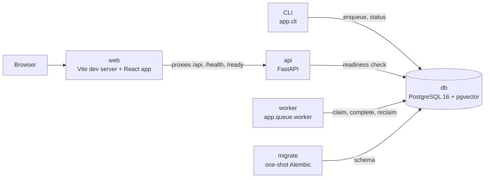
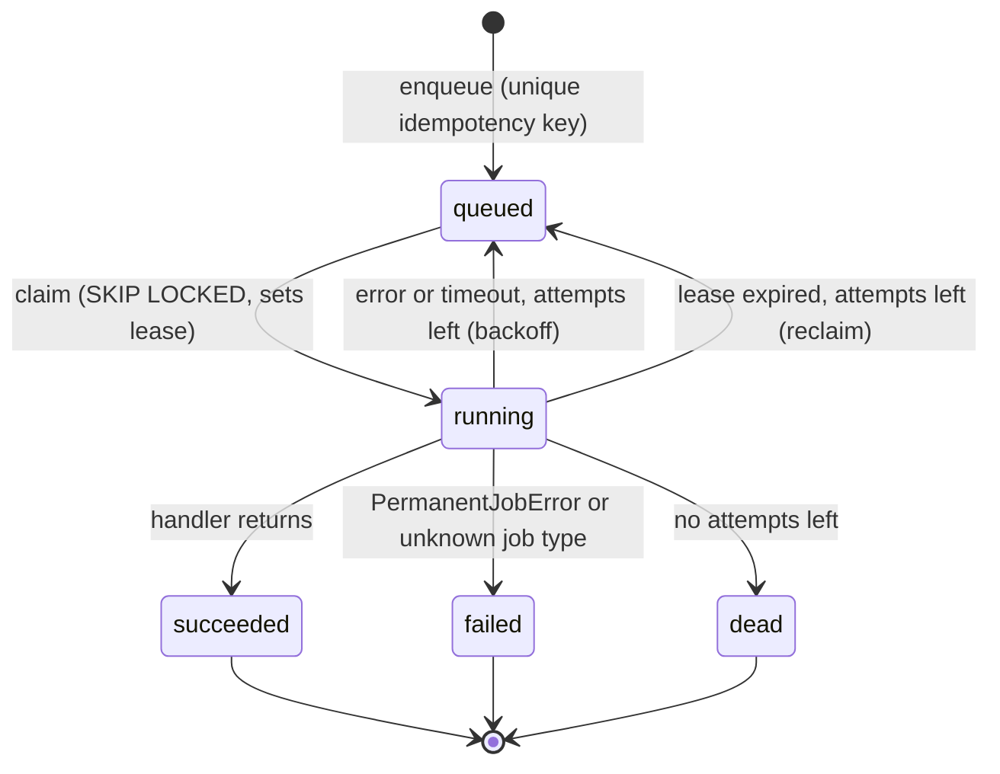

# Architecture

CareerPilot AI is a modular monolith: one backend codebase, run as an API process and a worker process, sharing one PostgreSQL database. This page describes what exists today. Feature modules are added in the increment that needs them.

## Processes (Docker Compose)

| Service | Role |
|---|---|
| `db` | PostgreSQL 16 with pgvector available. Data lives in a named volume. |
| `migrate` | Runs `alembic upgrade head` once and exits. `api` and `worker` wait for it to succeed. |
| `api` | FastAPI app (`app.asgi:app`). |
| `worker` | Polls the job queue and runs one job at a time. |
| `web` | Vite dev server for the React app. There's no production frontend image yet. |

All published ports bind to `127.0.0.1`.

## Backend layout

| Path | Contents |
|---|---|
| `app/core/` | Settings, JSON logging, middleware, error format |
| `app/db/` | Declarative base, timestamps, async engine and sessions |
| `app/api/` | `/health`, `/ready`, and the `/api/v1` router, which has no endpoints yet |
| `app/queue/` | Job model, queue service, handlers, worker |
| `app/cli.py` | Operator commands for enqueuing the sample job and checking a job |
| `alembic/` | Migrations |

## Request handling

Middleware runs in this order, outermost first:

1. **Secure headers:** added to every response, including error responses.
2. **Correlation ID:** takes a valid `X-Request-ID` or generates one, adds it to the response and every log line, logs the request, and turns unhandled exceptions into a clean 500.
3. **CORS:** only origins in `CORS_ALLOWED_ORIGINS` are allowed. In development the list is empty, because the Vite proxy makes API calls same-origin.

All errors use the format `{"error": {"code", "message", "details"}}`. Logs are JSON, with sensitive fields and URL credentials redacted. Exception messages and query strings are left out because they can contain user data.

## Job queue

Jobs live in the `background_jobs` table. `enqueue` joins the caller's transaction, so a job commits together with the change that created it.

- Handlers run outside the claim transaction, so no database transaction stays open during a long job.
- A lease lasts for the job's timeout plus a grace period. If a worker crashes, the job is reclaimed once the lease expires.
- Finishing a job only succeeds if `id`, `locked_by` and `attempts` still match, so a stale worker can't overwrite a newer attempt.
- Jobs run at least once, so handlers must be idempotent.
- On SIGTERM, the worker finishes its current job and then exits.

## Frontend

React, TypeScript, Vite, Tailwind and shadcn/ui-style components, with React Router and TanStack Query. `src/lib/api.ts` is the single API client: it validates responses with Zod and turns every failure into an `ApiError`. The one real page is System status, which shows live results from `/health` and `/ready`.

## CI

GitHub Actions runs three jobs on every push and pull request: `backend` (Ruff, mypy, pytest on real PostgreSQL), `frontend` (ESLint, Prettier, `tsc`, Vitest, build) and `compose-smoke` (builds and starts the full stack, then runs the sample job).

See [ADR 0001](adr/0001-stack-choices.md) for why these choices were made.
